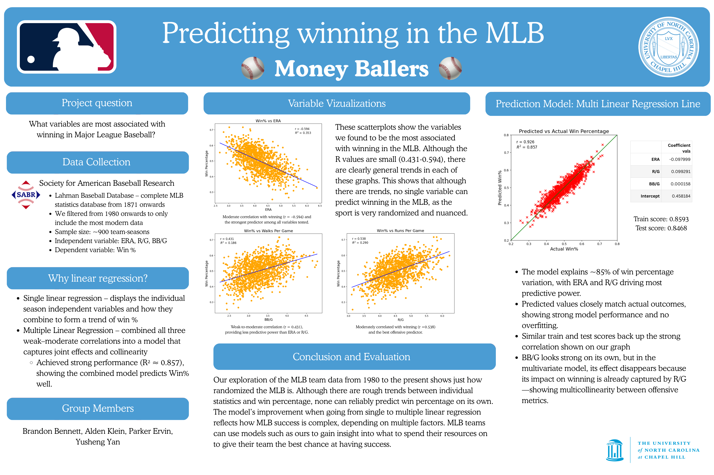

# Predicting Winning in the MLB

This project analyzes how different team statistics relate to Major League Baseball winning percentage. It was originally completed in December 2025 for my Introduction to Data Science course. After the original notebook was lost, I reconstructed the analysis from a saved PDF of the project to preserve and document the work.



## Project Overview

The goal of this project is to examine which team-level statistics are most useful for explaining and predicting winning percentage. The project uses historical MLB team data from the Lahman baseball database.

The main predictors analyzed are:

- ERA
- Runs per Game (R/G)
- Walks per Game (BB/G)

## Methods

The analysis includes:
- Data cleaning and filtering
- Correlation analysis
- Simple linear regression
- Multiple linear regression
- Train/test split for model evaluation

## Key Results

- The multiple linear regression model using ERA, Runs per Game, and Walks per Game explains about 86% of the variation in winning percentage.
- ERA has a negative relationship with winning percentage, while Runs per Game has a positive relationship.
- Walks per Game shows a positive relationship with winning percentage on its own, but adds relatively little information once ERA and Runs per Game are included in the multiple regression model.

## Tools Used

- Python
- pandas
- NumPy
- matplotlib
- seaborn
- scikit-learn
- SciPy
- Jupyter Notebook

## Files

- `Predicting Winning in the MLB.ipynb` — main analysis notebook
- `data/Teams.csv` — MLB team data
- `requirements.txt` — required Python packages

## How to Run

Install the required packages:

```bash
pip install -r requirements.txt